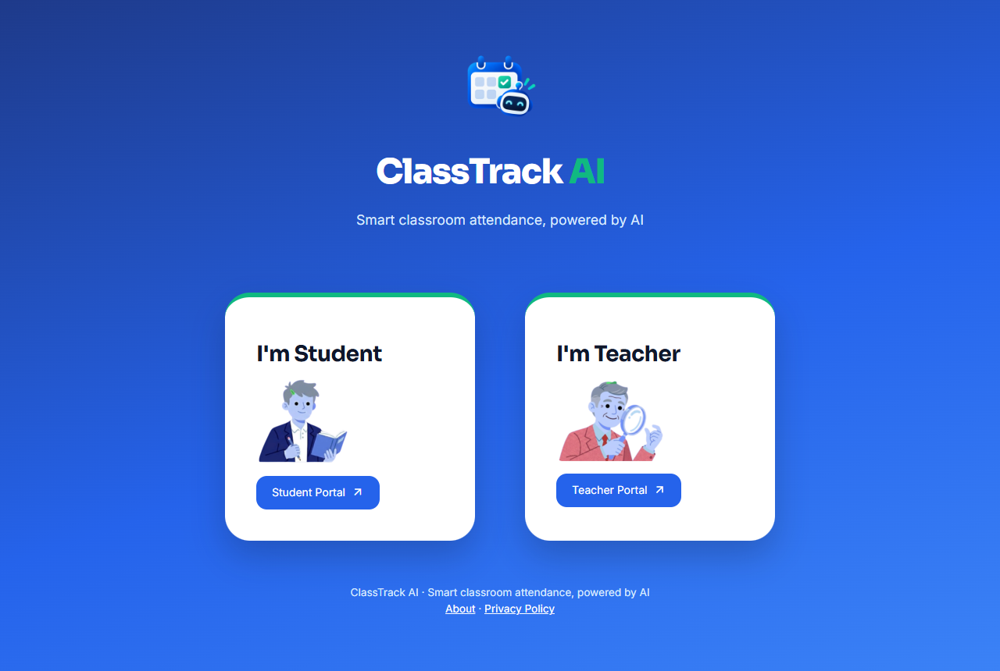
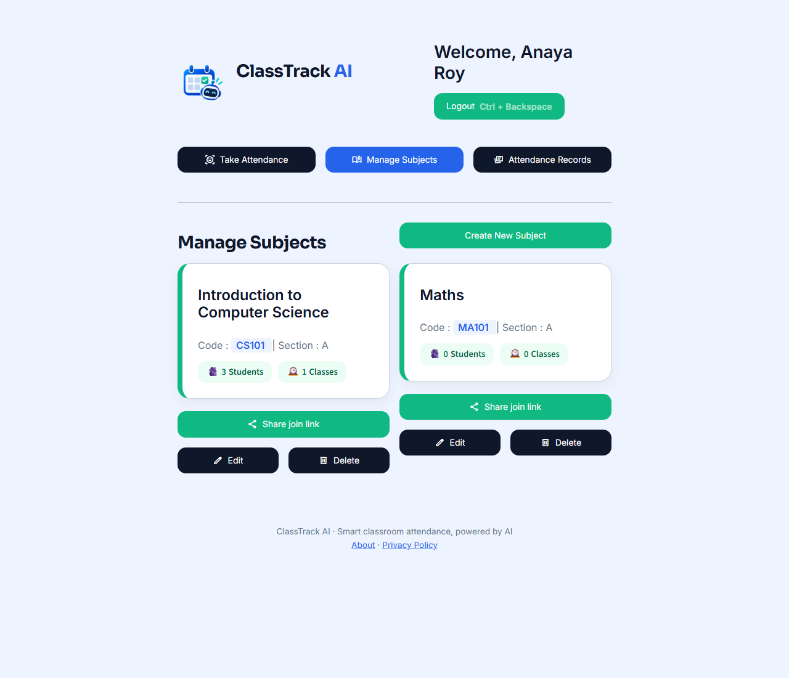
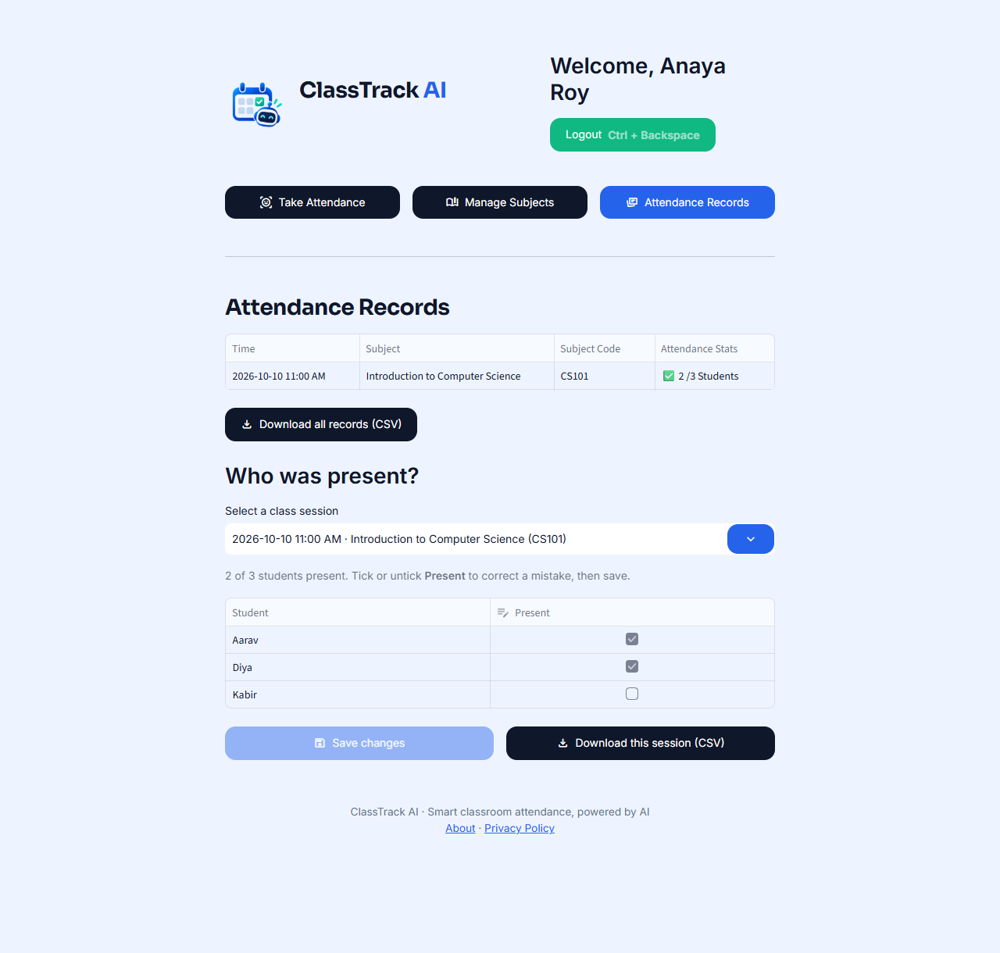
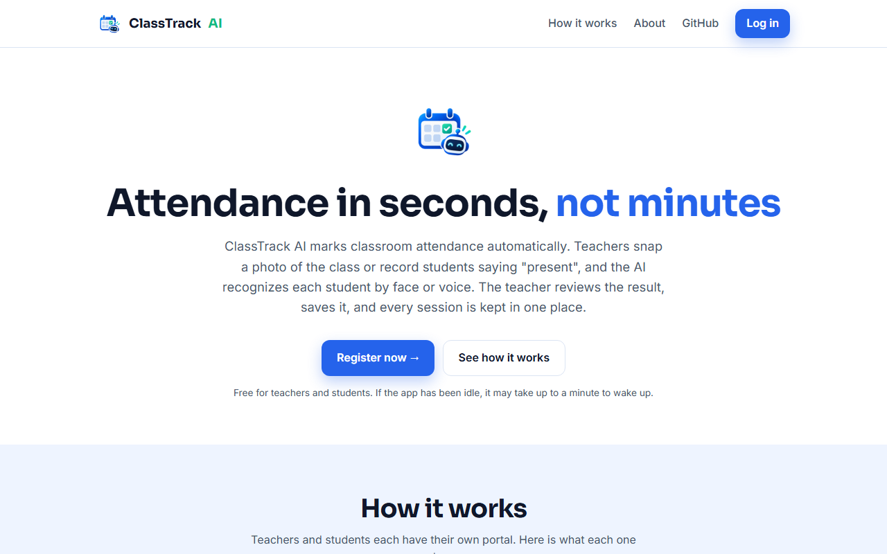
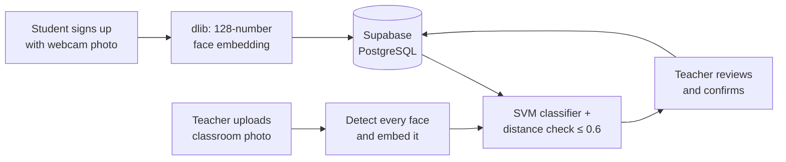

<p align="center">
  
</p>

<h1 align="center">ClassTrack AI</h1>

<p align="center">
  <b>Attendance in seconds, not minutes.</b><br>
  Classroom attendance with face and voice recognition, built with Python and Streamlit.
</p>

<p align="center">
  <a href="https://classtrack-ai-landing.vercel.app/"><b>✨ Try it live</b></a>
  &nbsp;·&nbsp;
  <a href="https://classtrack-ai-landing.vercel.app/about">About</a>
  &nbsp;·&nbsp;
  <a href="#getting-started">Run it locally</a>
  &nbsp;·&nbsp;
  <a href="https://classtrack-ai-landing.vercel.app/privacy">Privacy</a>
</p>

<p align="center">
  
  
  
  
  <a href="LICENSE"></a>
</p>

<p align="center">
  
</p>

---

## Why ClassTrack AI?

Calling out names or passing around a sign-in sheet takes time out of every class and is easy to get wrong.
With ClassTrack AI, the teacher takes a photo of the classroom (or records students saying "present"),
the AI recognizes each enrolled student, and the teacher confirms the result with one click.

## Features

**For teachers**
- Create subjects and share them with a **join link, QR code, or subject code**
- Take attendance from **classroom photos** (camera or upload) or a **voice recording**
- **Review** AI results before saving, with a warning for recognized students who aren't enrolled
- See **who was present** in every session, **correct mistakes**, and **download CSV** reports
- Edit or delete subjects

**For students**
- Sign up and log in with **Face ID**, no password needed
- Optional **voice enrollment** for voice attendance
- Join any number of subjects and track attendance per subject

**Privacy and security**
- Explicit consent before any face or voice data is stored; see the [Privacy Policy](https://classtrack-ai-landing.vercel.app/privacy)
- Only numeric embeddings are stored, never photos or recordings
- bcrypt-hashed passwords, minimum password length, and login lockout after repeated failures
- Row Level Security on every table; only the server-side key can access data

## Screenshots

| Manage subjects | Attendance records |
|---|---|
|  |  |

<p align="center">
  
</p>

## How it works



1. **Enrollment:** a student's face is converted into a 128-dimensional embedding with dlib's ResNet face recognition model. An optional voice sample becomes a 256-dimensional voiceprint with Resemblyzer.
2. **Recognition:** every face in a classroom photo is embedded and matched with an SVM classifier trained on enrolled students. A match only counts if it is within a Euclidean distance of 0.6, so strangers aren't marked present. Voice matches use cosine similarity (threshold 0.65).
3. **Confirmation:** the teacher reviews the result, saves it, and can correct it later in Attendance Records.

## Tech stack

| Layer | Tools |
|---|---|
| App and UI | Streamlit |
| Database | Supabase (PostgreSQL) |
| Face recognition | dlib, face_recognition_models, scikit-learn |
| Voice recognition | Resemblyzer (PyTorch), librosa |
| Data | pandas, NumPy |
| Other | bcrypt, segno (QR codes), Pillow |
| Landing page | Static HTML/CSS on Vercel |

## Getting started

### Prerequisites
- Python 3.11 or 3.12
- A free [Supabase](https://supabase.com) project
- A C compiler for `webrtcvad` (a Resemblyzer dependency): Build Tools for Visual Studio on Windows, `build-essential` on Linux

### 1. Set up the database
In Supabase, open **SQL Editor**, paste the contents of [`supabase/schema.sql`](supabase/schema.sql) and click **Run**.
Then copy the **Project URL** and the **service_role** (or **secret**) key from **Project Settings → API Keys**.

### 2. Run the app

```bash
git clone https://github.com/adididev/ClassTrack-AI.git
cd ClassTrack-AI
python -m venv venv
venv\Scripts\activate            # Windows
# source venv/bin/activate       # macOS / Linux
pip install -r requirements.txt
```

Copy `.streamlit/secrets.toml.example` to `.streamlit/secrets.toml` and fill in your values, then:

```bash
streamlit run app.py
```

### Configuration

Settings are read from environment variables first, then from `.streamlit/secrets.toml`.

| Name | Required | Description |
|---|---|---|
| `SUPABASE_URL` | Yes | Supabase project URL, e.g. `https://abcd1234.supabase.co` |
| `SUPABASE_KEY` | Yes | Supabase **service_role / secret** key. Server-side only, never commit it. |
| `APP_URL` | No | Public app URL for share links and QR codes. Detected from the browser address if not set. |

## Deployment

| Part | Where | How |
|---|---|---|
| App | [Streamlit Community Cloud](https://share.streamlit.io) (free) | New app → this repo, branch `main`, file `app.py`, Python 3.12. Add `SUPABASE_URL` and `SUPABASE_KEY` under **Secrets**. |
| Landing page | [Vercel](https://vercel.com) (free) | Import this repo, set **Root Directory** to `landing`, framework **Other**. |
| App (alternative) | Any Docker host, e.g. Render | Use the included `Dockerfile` / `render.yaml`. Needs at least **2 GB RAM** for voice recognition. |

> **Note:** free Supabase projects pause after 7 days without activity. Open the project dashboard to resume it.

## Project structure

```text
ClassTrack-AI/
├── app.py                    # Streamlit entry point
├── requirements.txt
├── supabase/schema.sql       # Database tables and security
├── src/
│   ├── branding.py           # Name, colors, links
│   ├── settings.py           # Reads env vars / secrets
│   ├── components/           # Dialogs, header, footer, cards
│   ├── database/             # Supabase client and queries
│   ├── pipelines/            # Face and voice recognition
│   ├── screens/              # Home, teacher and student screens
│   └── ui/                   # Global styles
├── landing/                  # Landing, About and Privacy pages (Vercel)
├── docs/screenshots/         # Images used in this README
├── Dockerfile, render.yaml   # Optional container deployment
└── .streamlit/               # Theme and secrets template
```

## Limitations

- Recognition needs reasonable lighting and faces turned towards the camera.
- Face login has no liveness check, so a printed photo of a student could be used to log in as them.
- Streamlit doesn't keep users logged in across page refreshes.

## Security

Please report vulnerabilities privately; see [SECURITY.md](SECURITY.md).

## Credits

ClassTrack AI is developed by [adididev](https://github.com/adididev).
Face recognition uses [dlib](http://dlib.net) and [face_recognition_models](https://github.com/ageitgey/face_recognition_models); voice recognition uses [Resemblyzer](https://github.com/resemble-ai/Resemblyzer).

## License

Released under the [MIT License](LICENSE).
